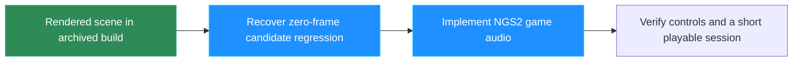

# Gravity Rush Remastered — Project Status & Comprehensive Investigation Report

**Project Title:** Native PC Port Investigation & Implementation for *Gravity Rush Remastered* (`CUSA01130` / `Bluepoint_GravityDazeHD_PS4`)  
**Timestamp:** 2026-11-03 (Local Time)
**Status:** Rendered gameplay, audible voices and streamed music have been demonstrated. The user now reports completing the crystal mission and reaching another episode. Earlier diagnostic runs crashed in the NVIDIA Vulkan driver; the root cause and all main-session playability remain unverified. Current evidence takes precedence over the historical notes below.

## Current checkpoint — controls, crash and audio follow-up

### Publication documentation and taskbar identity

The root README now documents player/developer requirements, extracted-game setup, controls, measured test coverage, limitations, source builds and experimental publication scope. `REFERENCES.md` lists upstream relationships, citations and retained license locations; `DEPENDENCIES.md` records six original vendor revisions. No upstream completion/benchmark claim is presented as local CUSA01130 verification.

The taskbar fix now sets native small/large HICONs and explicit per-window AppUserModel ID, relaunch command, display name and ICO resource through the Windows property store. Source and frozen-launcher self-tests read these properties back; this supplements the existing process ID, Tk icons and embedded EXE icon. An old pinned shortcut may still need replacement after reopening the current launcher.

The publication audit uncovered six nested dependency Git checkouts that a normal Git add/package inventory could treat as incomplete embedded repositories. Their `.git` metadata was preserved outside the project in `references/dependency-git-metadata`; the existing source and local FSR changes are now ordinary vendored files. A clean export of Git-eligible source configured successfully through CMake without the external reference checkouts. This was a configure check, not a fresh full native rebuild.

`app/scripts/audit_publication.py` found no forbidden local/game-data paths, common credential-pattern matches, or oversized eligible source files. The 448-byte `runtime/tests/data/isa_fixture.bin` is an explicitly identified synthetic instruction-rewrite fixture generated from the project's test code, not game data. This scan is scoped evidence, not a legal/security guarantee. No files were staged, committed or pushed. Earlier player ZIPs predate the vendor-source correction; use a newly generated ZIP for sharing.

### Self-contained launcher inside the project

The current entry point is `Lian-Port-Gravity/Launch_Lian_Port.exe`, with bundled Python/Tkinter support in ignored `_internal` beside it. The former executable outside the repository was preserved in `local-data/launcher-outside-before-contained.exe`; the workspace shortcut now targets the inside executable. This supersedes the earlier external-launcher layout below.

`Build_Player.ps1` builds/installs a PyInstaller 6.22.3 windowed folder bundle and packages it with the tested native runtime, source and notices. Python and Tcl/Tk are included; players no longer need an installed Python. Development builds still require the documented compiler/Python tools. The player ZIP has one top-level `Lian-Port-Gravity` folder, containing the launcher, `_internal`, `app`, source and an empty `game/CUSA01130` folder. Proprietary game data, saves and prepared images remain excluded.

Verification: a renamed-location frozen-launcher self-test returned exit 0 with PATH restricted to Windows directories, `frozen=true`, Tcl/Tk 8.6.15, bundled symbol metadata present and no attached console. A separate portable-package GUI test used an isolated copied save and the same restricted PATH: clicking Launch prepared the game and started the packaged native runtime, which rendered the title menu. No external Python, compiler or source checkout was needed during that launch. The generated boot hash matches the previously tested image. Test evidence is in ignored `local-data/frozen launcher relocation test` and `local-data/contained-player-game-test`. The game and launcher test windows were closed intentionally. Main saves are unchanged. Full-story compatibility remains unverified.

### Player setup and checkpoint inventory

`Setup.ps1`, `app/player_setup.py` and the launcher's first-launch preparation path validate extracted CUSA01130 files, require libc/FIOS2 and arc content, and fingerprint preparation inputs. Preparation uses a staging folder and preserves the previous boot image on failure. The real-game setup test generated SHA256 `709BF66D26A13F3CB81AC3677EFAF1A77D934D4E7BF9A6B6D209CEF5DDA8766E`, exactly matching the previously tested boot. Six setup/packaging tests passed, including wrong region, changed inputs, missing modules, preserved previous boot on failure, rejected corrupt/path-escaping runtime bundles, and PE dependency parsing. Runtime dependency checks resolved 98 local DLLs. The launcher starts the console-subsystem guest helper with CREATE_NO_WINDOW to prevent a separate console during game startup.

The build script now stages the helper and recursive DLL dependencies rather than assuming an existing bin folder. `app/scripts/package_player.py` assembles a local experimental ZIP including source and license notices, while auditing out game data, generated boot images, saves, caches, logs and settings. Python 3.11+ with Tkinter remains a player prerequisite. No upload or public release is performed.

`app/scripts/checkpoints.py` catalogs local save metadata and makes hash-checked isolated replay copies. The main save now reports Episode 3: Home Sweet Home (Completed), play time 01:07:11; earlier checkpoints cover Episodes 1–3 only. No later-game or ending checkpoint is currently available. See root `CHECKPOINT_TESTING.md` for the transition acceptance matrix. Metadata is not proof that the next episode loads or that the ending is reachable.

Player-package validation succeeded: source and notices were included; the independent ZIP audit rejected no files; no game/save/boot/cache inputs were included. The tested clean runtime installation resolved 99 DLLs without searching MSYS2, and its probe hash matches candidate 17. A clean packaged launcher selected its bundled runtime and fresh user directory, correctly reporting the absent user-supplied game and boot image. A separate real-game first-launch integration test prepared an identical boot and issued one mocked process launch with CREATE_NO_WINDOW, without starting or changing the main save. Evidence is under ignored `local-data/first-launch-integration`, `clean-player-launcher.json` and `runtime-install-check`.

The isolated completed-Episode-3 replay loaded the 01:07:11 checkpoint, advanced through home/manhole tutorial screens, returned to rendered sewer gameplay and opened the populated map with Esc. No fatal fault or rendering-scope recovery was found at inspection. Its source main-save SHA256 remains `45E78545325434E93873679557A30BCC4A7CE8D51B651FACC55980CFF6A5A4D8`. Replay profile: `app/user/replay_20261103_064559_164424`; log: `app/logs/completed_episode3_transition_20261103.log`. The process was intentionally closed using Alt+F4. This is checkpoint resume coverage, not Episode 4 or ending verification. The player package remains experimental and unpublished.

### Repository layout — current paths

This Gravity Rush project now lives at `C:\Testing PS4 Port\Lian-Port-Gravity`, initialized as a local Git repository on branch `main`. No files have been staged or committed, and no remote is configured. Modified runtime source is in `runtime`; launcher source, scripts, reports and installed local runtime are in `app`. The clickable executable and shortcut remain outside the repository at `C:\Testing PS4 Port`. All reference checkouts are outside it in the sibling `references` folder. The separate Test PS2 folder is untouched.

The decrypted game and original package are preserved in ignored `game`; saves remain in their separate existing `app/user` profiles. Git ignore checks passed for game files, boot images, runtime installs, saves and build outputs. SHA256 checks matched the pre-move main autosave, generated boot image and candidate-17 executable. Local settings now use `../game/CUSA01130`. Preparation, inspection scripts, launcher bootstrap and build scripts resolve the new layout. Required shadPS4 symbol metadata was copied, with its license notice, into `app/data` so preparation does not require the external reference checkout.

The old CMake output is preserved in ignored `runtime/out/gpu-before-reorganization`; fresh configuration succeeded at `runtime/out/gpu` using the new source paths. The tested executable itself was not changed. The external GUI launcher rebuilt and returned exit 0. Historical absolute paths elsewhere in this report describe the former layout; use the root README and this section for current paths.

After correcting the folder name to `game`, the relocated windowed-launcher smoke test returned exit 0, reported no preflight errors, resolved the existing main save and candidate 17 at their new locations, and confirmed no attached console (`app/logs/relocated_launcher_check.json`). This organization check did not run a new gameplay session.

### Branded console-free launcher startup

Use `C:\Testing PS4 Port\Lian Port.lnk` or `Launch_Lian_Port.exe` beside the Python launcher. The new Windows GUI executable embeds the existing blue Lian Port ICO, resolves `pythonw.exe`, and starts the launcher without a console. The compatibility batch file forwards to this executable and exits; opening a batch file may still briefly show a command window, so the shortcut/executable is preferred. Python source file associations remain unchanged.

The Tk launcher sets `LianPort.GravityRush.Launcher` as its Windows taskbar identity before window creation and applies the ICO to both current/default windows. Startup smoke testing passed with this identity, nonzero small/large native icon handles and no attached console (`logs/launcher_window_check.json`); Python compilation passed, and the native entry point is a Windows GUI subsystem executable. Source and reproducible build script are in `scripts/launcher_start.c`, `.rc` and `build_launcher_start.ps1`. See `LAUNCHER_START.md`. Close an older launcher and open the new shortcut to receive these changes.

### Display modes and cursor confinement — current build 17

The launcher now selects `bin/gravity-probe-display17.exe`, SHA256 `01D36B3991ACCC170292D1AD600D8D1A9E744D02061FEBB9A17180AFE6449D4F`. Restart the launcher to pick up this build. Window mode, VSync and presentation FPS selections are saved on launch and exported as runtime overrides; resolution, FSR and sharpening controls remain prototypes. Explicit mode overrides take precedence over the legacy fullscreen environment flag.

Gameplay retains relative mouse aiming. Esc / menu / text entry releases relative aiming while keeping the cursor confined to the focused game window. Minimizing or losing focus releases confinement; returning to the game restores it. Alt+Tab remains available. Actual SDL window tests passed windowed and borderless transitions, paused confinement with a visible cursor, minimization release, restoration and relative-mode recapture. Windows rejected exclusive display switching with `DISP_CHANGE_FAILED` here, so exclusive requests now fall back to borderless with a diagnostic message. True exclusive fullscreen remains unverified on this machine. Evidence: `SpartanPort-main/out/display-mouse-test.stdout.log` and `.stderr.log` (exit 0). Graphics settings override tests and launcher label/environment checks passed; the runtime rebuilt successfully.

The first rebuilt candidate 16 rendered its title menu, then a watchdog diagnostic crashed at `ucrtbase.dll+0xed8b0`. Symbolization points to `runtime_thread_dump_watchdog`, which re-read a concurrently cleared `blocked_on` pointer between its null check and `strcmp`. Candidate 17 uses one atomic pointer snapshot. The watchdog also now reads the Vulkan frame counter instead of an unused legacy notification counter that falsely reported no frames during visible rendering. Low-draw title/menu screens can still produce an idle warning; this is not proof of a black screen.

Candidate 17 ran in borderless mode with mouse lock enabled, loaded a separate copy of the one-hour Episode 3 save, rendered Old Town gameplay, and opened the map with Esc. Its audio stats showed nonzero output and zero starvation in the inspected intervals. No fatal fault or rendering-scope recovery was found during inspection. This short run does not establish long-term stability or full-game completion. Evidence: `logs/candidate_display17_validation_20261103.log`; isolated profile `user/display16_validation_20261103`. The main launcher profile remains separate. The diagnostic run was deliberately closed with Alt+F4 after checking the map.

Candidate 15 was also launched under validation and rendered the sewer-to-town transition without VUID, fault or rendering-scope recovery at inspection; the older statement below that it had not launched is historical. Remaining acceptance work is sequential episode transitions, boss/contextual actions, save/reload and the ending, plus extended audio/video synchronization and crash testing on CUSA01130. Working controls and sound do not establish start-to-ending compatibility.

### Repeatable movement replay and execution-scope guard

The first candidate-14 run reached render 112500 (about ten minutes) with zero decode errors and no recorded fault, then was intentionally closed using Alt+F4; exec session 27418 returned exit 0. A second isolated run uses `user/present_sync14_controller_20261103`, exec session 16528, log `logs/candidate_sync14_controller_20261103.log`. It explicitly enables the runtime's pre-existing SPARTAN_PAD_FILE test interface. `scripts/controller_probe.py` holds a validated controller command for 0.05–5 seconds, clears it in a finally block, and records each pulse in the profile's `pad_probe.jsonl`. It does not inject Windows keyboard/mouse input. The normal launcher does not enable this interface.

This replay exercised right-stick camera movement, gravity float/shift, wall walking and gravity reset. It then used the game's own sewer-shortcut prompt to transition to the town square, where NPCs, the fountain and HUD rendered after completed fade-in. Walking to the furniture information marker opened the conversation and advanced through several comic dialogue panels. At render 204375, the run had 534 voice starts, 1268 finished audio blocks and zero decoder errors or recorded faults. These are scoped live checks, not an Episode 3 completion or full-game stability claim. Main save data remains untouched.

Downloaded source-only reference files from `LucaPazienza/gravityrush_pc`, pinned revision `9108d33eeeb25910ce484a64df535028fe8824e0`, into `out/reference_gravityrush_pc`, including commit metadata and GPL license. Its scheduler explicitly documents the same NVIDIA vkCmdEndRendering null+0x130 failure. It also contains the presentation drain added locally, plus execution-time rendering-scope guards. Its full-story playthrough claim applies to CUSA01113, not the local CUSA01130 dump.

Adapted the execution-time guard into shared `vk_render_scope.h` and scheduler begin/end/submission paths. It suppresses an end without an executed begin, closes an old scope before a replacement begin, and closes any outstanding scope before command-buffer end. Bounded recovery logs remain visible; a recovery indicates a sequencing problem rather than proof of correct rendering. `render-scope-test` passes with a simulated driver that asserts on every invalid begin/end; balanced, duplicate-end, replacement-begin and submission-boundary sequences all remain valid. Full runtime builds. Attribution and scope are recorded in `SpartanPort-main/GRAVITY_RUNTIME_UPSTREAM.md`.

Staged `bin/gravity-probe-render-scope15.exe`, SHA256 `2B38BEA23D63E68B4EE8BFD5D46F30E6165B6373E01B9CE104D9BB403C73F0FB`. It is not launched or selected yet; candidate 14 remains the launcher default until live verification. Candidate-15 Vulkan validation, recovery counts, transitions and long gameplay still need checking.

### Presentation crash reproduction and candidate 14

Candidate 13 reproduced the same `nvoglv64.dll+0xe1a0a0` read fault at `0x130`; exec session 62298 returned exit 3. Its NGS2 counters had reached render 73125 with 275 voices, 507 finished blocks and zero decode errors. The new stack-candidate output contains executable return addresses. Symbolizing candidate 13's PE addresses (ImageBase `0x140000000`, subtracting one from return PCs) identifies `Scheduler::EndRendering` / `vkCmdEndRendering`, with further candidates in `Runtime::FlushBarriers` and `Presenter::PrepareFrame`. Full inlining output is saved in `logs/candidate_map13_fault_symbols_20261103.txt`. These are stack candidates, not a fully unwound trace.

Code inspection found that `PrepareFrame` accesses the draw scheduler, texture cache and upscaler display without first joining DrawPipe's recording thread. That violates the same ownership requirement enforced by the rasterizer's other GPU-thread operations and can let BeginRendering race presentation's EndRendering/Transit. Added `rasterizer->DrainDrawPipe()` at the start of `PrepareFrame`, and before blank frames that use the draw scheduler (not the independent present-thread scheduler). This is a targeted race correction; it is not yet proven to eliminate the observed driver fault.

Built and staged `bin/gravity-probe-present-sync14.exe`, SHA256 `B17FD6F1EDE02672962B8212E53308442A001BDDCF4CCF6D2510F3D2967048B7`. A fresh isolated replay is running in exec session 27418 using `user/present_sync14_replay_20261103`, log `logs/candidate_present_sync14_replay_20261103.log`, validation disabled. It loaded the one-hour Episode 3 checkpoint and rendered Kat, the sewer, HUD and subtitles. At render 90000 (about eight minutes of 256-frame, 48 kHz audio rendering) it had 73 voice starts, 365 finished blocks and zero decode errors or recorded faults, beyond candidate 13's final render counter of 73125. Normal late intervals were about 24 FPS. This run has much less action than candidate 13; it does not prove a crash fix or completed mission transition. The launcher now selects candidate 14, with candidate 11 as fallback; no main save was changed.

Important limitation of the race hypothesis: flip signaling can run as an ordered DrawPipe task on stage B, where `DrainDrawPipe()` intentionally does nothing. The new guard protects GPU-command-thread presentation entries, but the sampled wait statistics have not demonstrated a wait at `PrepareFrame`. Therefore the added guard is not yet established as the cause of the longer survival. Further reproduction and recording-scope/thread evidence may still be needed.

The user reports that the crystal mission is finished and they reached another episode. The latest inspected save identifies Episode 3: Home Sweet Home. After previously stopping Computer Use, the user explicitly authorized another isolated diagnostic replay from a copy of that save. That replay has now ended; no game window or live exec handle remains. The ending log includes runtime counters but no captured exit code, so its exact exit cause is not established.

The launcher currently selects `bin/gravity-probe-present-sync14.exe`, with candidate 11 as fallback. In the PC preset, Circle is F/Backspace, M and Esc are Options (map/game menu), Left Alt is R2 evade, and R is L2 alone. E/Tab retain contextual touchpad clicks. Candidate 12 confirmed that Options opens the Episode 3 map and F/Circle closes it, while the old M touchpad click did nothing. Candidate 13 changes M to Options; its live screenshot shows the map open after M, and the guest log confirms OPTIONS press/release. `pad-map-test` passes the corrected M path, preserved E touchpad action, Alt+W evade and standalone L2. Live evade/combat/finisher coverage remains incomplete. The original controller glyphs remain visible in the game; Circle prompts use F, held if required.

Candidate 13 SHA256: `EEAFA2284AD4023B6F6762F66AE2A1A8C57C0300DFA06C08967453813DE0A768`. Evidence: `logs/candidate_map13_replay_20261103.log`, isolated profile `user/fault12_replay_20261103_01`, exec session 62298 (running at inspection, map open). It includes candidate 11's audio boundary fix and candidate 12's diagnostic stack evidence. Candidate 12's preceding replay was intentionally closed using Alt+F4 after checking the map; exec session 89655 returned exit 0. It was not a crash. Neither short run establishes full-game stability.

Candidate 13 follow-up: the map's Finding Furniture information entry accepted Space to set navigation, then returned to gameplay with a 130-yard destination marker. Shift entered gravity float; C returned Kat to the ground. Left Alt + W produced a visible evade effect/animation and guest R2 press/release, without L2. These are live controls checks in the Episode 3 sewer; the character has not yet reached the next mission marker or completed this episode. No new crash cause is established.

`logs/candidate_avsync8_replay_20261102.log` and `logs/candidate_controls10_20261102.log` both end with a read fault at address `0x130` in `nvoglv64.dll+0xe1a0a0`. This establishes a repeated crash signature, not its root cause. The user's later successful crystal-mission completion does not invalidate these earlier failures or establish full-game stability.

An optional `Launch_Vulkan_Diagnostic.ps1` opens the launcher with a project-local Khronos validation layer; it never starts a game automatically. Its `-CheckOnly` mode passed with only project DLLs and Windows directories on PATH (`logs/vulkan_validation_local_check.log`), without depending on MSYS2 being on PATH. See `tools/vulkan-validation/README.md` for provenance and usage. Normal launches keep validation disabled.

Candidate 11 contains an ATRAC9 descriptor-boundary correction and now has live evidence in `logs/candidate_validation_boundary11_20261102.log`, using isolated `user/validation_boundary11_20261102_2025`. It loaded the Episode 3 save, rendered comic dialogue and gameplay HUD, and logged nonzero normal-port audio. At render 84375 it had played 831 voices and finished 1066 blocks with zero decode errors. A full scan found no VUID or fatal-fault entries. Validation slowed gameplay substantially (late intervals roughly 12–20 FPS); this is not evidence of normal-mode performance or a driver-crash fix. The preserved replay save says play time 001:00:15; the main launcher remains on the user's separate 55-minute profile, without overwriting it from diagnostic progress.

A real trimmed 300-sample block followed by a fresh 1024-sample superframe reproduced `ERR_UNPACK_SUPERFRAME_FLAG_INVALID` before the fix. Resetting decoder phase only at a full-descriptor fresh-superframe boundary makes all 1324 samples render without errors; baseline NGS2 tests also pass (`SpartanPort-main/out/ngs2-test.stdout.log`). Longer-playback stability and subjective sound/video synchronization still require verification.

The newer `bin/gravity-probe-fault-evidence12.exe` (SHA256 `3B8F7D12DDE00D99EA5E02C7F676AC9FDAFB98E4E524A5E8BD42EB34B1B58284`) is staged separately, not selected or launched. The existing rbp-chain fault output is insufficient when the driver uses rbp as a general register. The new bounded stack scan reports module-backed executable pointers as candidates, explicitly not an unwound call stack. `fault-stack-test` passes executable/data filtering, capacity and unreadable-stack checks; the full runtime builds. This prepares stronger evidence for another reproduction and does not change gameplay behavior.

The latest inspected autosave is in `user/controls10_replay_20261102`: 18422 bytes, modified 20:10:49, SHA256 `62AEA06E69422C12AC4E8FAD3E4FDFDC87932E4091DC1CDF71B6BE79093C0A52`. Its `SAVEAUTO.sce_sys/param.bin` says **Episode 3: Home Sweet Home**, play time **000:55:00**. The log records `clear_mission eps1_a`, `free_eps1`, then internal mission `ep05_a`, completed fade-in and a tutorial. Internal `ep05` therefore must not be reported as displayed Episode 5. At 20:23 a byte-verified backup of this profile's savedata and the previous launcher settings was created at `user/checkpoint_after_controls10_20261102_202335`. The launcher now points to `user/controls10_replay_20261102`, preserving the newer progress; no original save contents were overwritten. Restart an older launcher window to load this setting. Historical sections below describe earlier runtime selections and limitations, some since superseded.

### Offline diagnostic verification

The renderer classified Vulkan validation warnings as `info`, below the default GPU log threshold of `warning`. A real headless Vulkan messenger probe reproduced the missing warning while its error marker was visible. `vk_platform.cpp` now preserves warning severity. The new `vulkan-validation-log-test` submits warning/error messages through the actual Vulkan messenger and renderer sink; both markers are present after the fix, with no unexpected VUIDs in the instance-only test (`SpartanPort-main/out/validation-after.stderr.log`). The runtime builds successfully. This is a diagnostic correction, not a fix for the gameplay driver crash.

`Launch_Vulkan_Diagnostic.ps1` also sets `SPARTAN_GPU_LOG=info`, allowing the existing staged controls10 executable to capture validation warnings without replacing it. Check-only and caller-environment restoration passed. No game was launched.

Extended the real ATRAC9 regression to compare every PCM sample of sixteen aligned descriptors and 113-byte data-only fragments against an unsplit decode. Both match exactly; the trimmed-descriptor case and baseline NGS2 tests also pass. This verifies that the boundary fix retains codec overlap for the tested ordinary stream paths; live audio stability remains unverified for the new build.

## Native NGS2 integration — 2026-11-02 evening

### Follow-up verification and current state

#### Candidate 8 and launcher follow-up

Candidate 8 is live-tested in `logs/candidate_avsync8_replay_20261102.log`, exec session 25601, using a fresh copy of the preserved 19:22 autosave in `user/avsync8_replay_20261102`. It renders the `ep03_b` combat tutorial with HUD and enemies. The user supplied input during the replay; automated game controls were stopped. The log then records `clear_mission ep03_b`, `mission_name ep03_03c`, `mission_name eps1_a`, and completed fade-in (lines 4545–4697 at inspection). This verifies a hot mission transition in this run; it does not prove all chapter boundaries or the earlier Episode 1-to-2 failure are fixed.

Streamed music now stays audible across consecutive intervals. At render 11250, the mixer had finished 22 blocks with zero decode errors and the active sampler had decoded 1763328 samples. Later, at render 82500, the totals reached 915 voices played, 1058 blocks finished and 3 decode errors. Normal-port RMS remains nonzero during active sounds. Thus the new block handling has live continuity evidence, but decoder errors during longer playback remain unresolved. No fatal fault was seen in this log at inspection.

The launcher now selects `gravity-probe-ngs2-avsync8.exe` with native NGS2 enabled; fallback is the previously voice-tested candidate 6. Bounded NGS2 tracing is off by default, available via LIAN_NGS2_TRACE=1. The save root is now explicit via `--user`, and Save/Backup uses that root's actual `savedata/1/CUSA01130` path (previous code incorrectly used `user/home/1/savedata/CUSA01130`). `launcher_settings.json` points to the current user-controlled profile `user/avsync8_replay_20261102` so future launches preserve its progress. The original settings were backed up to `launcher_settings.before-profile-20261102.json`; earlier saves remain untouched. Launcher syntax, staged runtime selection and existence of its chosen save were checked. Restart an older launcher window to load the new code/settings.

Candidate 9 (`bin/gravity-probe-ngs2-avsync9-diagnostic.exe`, SHA256 `BF8BA26765A02125113FEE00E9ACAC69E7A7DD2BCC2CAA340BCC0ADA6CB2CBB9`) is separately built, not selected or launched. It adds bounded error metadata (codec code, frame/block, available/used bytes and config) without requiring full trace spam. This is the next diagnostic for the 3 observed decoder errors; no speculative decoder workaround was applied to the user's live session.

The user confirmed **in-game voices are audible** in candidate 6. A full-log scan also corrects the earlier silence assessment: candidate 5 already recorded nonzero normal-port audio at lines 964, 999, 1385 and 1734 (peak up to 0.515719); candidate 6 records nonzero port-0 audio too. Earlier updates inspected only the newest silent intervals. Candidates 2/4 had no nonzero normal-port intervals. The rack-target routing correction therefore has live output evidence; continuous music and sound/video synchronization are still not fully verified.

The user took control of candidate 6 and progressed into another scene; no further automated game input was sent after this was detected. Its process subsequently exited (exec session 19121 completed; game absent from window inventory). The cause of exit is not established. Their newest SAVEAUTO is in `user/episode3_native3_20261102_1920/savedata/1/CUSA01130`, 18266-byte data.bin modified 19:22:17. Preserve this progress; the normal launcher still uses the older default profile/runtime and must not silently replace it with an earlier checkpoint.

Additional runtime changes now distinguish full flag-1 streamed block descriptors from flag-3 data-only continuation, retain individual block sample counts, wait for refills and reset a reused sampler's old queue index. Baseline tests plus a real ATRAC9 sequence across sixteen full descriptors pass (exit 0, `SpartanPort-main/out/ngs2-test.stdout.log`). These new stream changes have not yet been live-tested. Candidate 7 contains them without the subsequent video change.

AvPlayer now selects the latest queued video frame already due at its playback clock, recycling superseded buffers and leaving future frames queued. Previously it delivered one overdue frame per request, which could preserve video lag after a stall. The new `avplayer-frame-selection-test` passes delayed/exact/future/duplicate timestamp and buffer-ownership checks while retaining every frame for free-running clients. Full Ninja build passes. Candidate `bin/gravity-probe-ngs2-avsync8.exe` SHA256 `1DEC666FE6FDE34D57DE4C0CE410BE38A9E748BB1B90CBCD511231A355879DF8` includes both new stream handling and frame selection (Windows GPU code is statically linked). It is staged separately, not selected by the normal launcher and not live-tested yet. The user's reported audio-leading-video symptom is not claimed fixed.

Launcher Motion & Controls now recommends a controller, with a scrollable controller-prompt/PC-key/action table. Explicit gaps: M unbound, Ctrl also presses R2 (no L2-only key), touchpad gestures/finishers not fully verified. Added Insert for the port overlay. The Display & Graphics combobox style explicitly sets readonly/selection colours and popup-list colours; visual inspection of the selected values and an expanded resolution list confirms readable light text on a dark background, with a blue selection. Motion & Controls layout was visually checked too. Launcher AST syntax passes. Two launcher previews may remain open; no game was launched from them.

Adapted the GPL-licensed PS4 NGS2 mixer and baseline tests from `gminustwo/minustwo`; provenance and changes are in `SpartanPort-main/NGS2_UPSTREAM.md`. Native bindings are opt-in with `LIAN_NGS2_NATIVE=1`; the normal launcher remains on its previous candidate. Added the ten scoped NGS2 NID mappings to `src/import_names.inc` (diagnostic names in `missing_154.inc` alone did not allow runtime resolution). Real allocator-based system/rack creation now invokes the game's callbacks and returns distinct handles. Normal creation, destruction and callback ownership pass tests.

`ngs2-test` passes its upstream PCM/parser/stream/matrix/limiter regressions plus local tests for numeric ATRAC9 config, allocator lifecycle/failure, empty waveform-list close and rack-target routing. A local game music fixture renders 16384 samples through the native sampler/mastering path, peak 0.065460, no decoder errors. Evidence: `SpartanPort-main/out/ngs2-test.stdout.log` (exit 0). Ninja builds the runtime successfully. These checks do not establish live-game sound or synchronization.

Isolated native candidate 2 loaded Episode 3 and rendered comic dialogue, but normal audio remained zero. Bounded tracing now wraps real NGS2 bindings too. Candidate 3 exited during startup with a write fault at `ntdll.dll+0x44d05`; causality is unproven. Candidate 4 survived startup and exposed a concrete routing failure: PARAM_PATCH receives rack handles (default input 0), but the reference mixer accepted only voice handles, returning `0x804a0300`. The local adaptation now resolves that default rack input to its first voice and rejects cross-system connections. The trace also showed a `{data=NULL, flags=0, count=0}` close after sound-effect waveform blocks; that now closes the list without deleting queued audio. Both behaviors have regression tests. No game executable/script was patched to skip waits.

Current isolated run: `bin/gravity-probe-ngs2-native5.exe`, SHA256 `B93571084FCDAF78E51DAEAE08D38060598347F7239837ADD25604D5AAAC7F73`; log `logs/candidate_episode3_native5_20261102_1935.log`, exec session 5932, copied save profile `user/episode3_native3_20261102_1920`. Title rendering observed; Continue selected, pending save chooser/confirmation. Prior diagnostic runs were closed/exited before this one started. The rack-route fix still needs live audible-output verification; normal audio stats before menu input were zero.

Follow-up: candidate 5 loaded the copy and rendered the `ep03_a` comic ("Were you the one changing gravity?"). Normal audio ports still report zero RMS/peak even after the routing fix; no `0x804a0300` patch failures remain in this log. Sound is not yet repaired. The earlier theory that a zero-size unused render buffer suppressed mixing was disproved: the expanded trace shows ten valid float output buffers, all sized for 256 frames. Do not add a workaround for that unobserved condition. Candidate 4 survived startup; candidate 3's host fault has not recurred in candidates 4/5, but its cause is still unresolved.

Separately built `bin/gravity-probe-ngs2-native6-diagnostic.exe` (not launched) adds optional `LIAN_NGS2_STATS=1` snapshots of active voice flags, block/read positions, sample/byte counts, envelopes and default port routing every 1875 render calls. Bounded trace now includes matrix levels and envelope points as well as all ten render descriptors. The next diagnostic should use these snapshots to distinguish a stalled sampler from a muted/routing problem, rather than guessing another compatibility patch. Trace ABI/errno/safe-read/budget tests pass after these changes.

The user also reports sound leading visible movement. AvPlayer currently derives its clock from the last audio frame handed to the game plus elapsed host time; delivery is not necessarily audible playback. This is an investigation lead, not a verified cause or synchronization fix. Audio/video sync, hot chapter transitions, and start-to-end progression remain outstanding.

## Earlier current evidence — 2026-11-02, 18:55 local

- The user explicitly authorized an isolated replay. `candidate_episode3_replay_20261102.log` shows a successful cold load of `ep03_a`, with rendered dialogue observed in the game window. Its process has exited; its cause of exit was not established. This does not prove the earlier hot transition is repaired.
- Audio ports 0 and 17 continuously received zero RMS/peak samples. `prepare_gravity.py` confirms NGS2 calls are synthetic: all racks return `0x2001`, system/voices share `0x3001`, and VoiceGetState/Render return success without producing output. The observed 48-byte state contains unwritten stack contents. Host AudioOut delivery alone cannot restore missing sounds.
- Added `SpartanPort-main/src/runtime_ngs2_codec.c/.h`: a stateful ATRAC9-to-float decoder for the NGS2 sampler. It accepts split compressed input, retains partial output, validates channels/rate, and waits for a complete superframe before decoding. Reset recreates the LibAtrac9 handle because reinitializing it retains old overlap samples.
- Local integration test reads `out/ngs2_audio/bgm05.sxd2` extracted from the existing dump. Config `0xfe740df0`, stereo/48 kHz, 448 bytes and 1024 samples per superframe. Sixteen superframes decode with RMS 0.011535 and peak 0.065460. Arbitrary 37-byte input/71-frame output chunks and reset match whole-buffer decoding exactly; incomplete input waits. Test exit 0: `SpartanPort-main/out/ngs2-codec-test.stdout.log`. No game data is embedded in tests.
- `scripts/extract_ngs2_audio_fixture.py` reproduces that read-only extraction. The codec has not yet been connected to voice allocation, block scheduling or mixing. The game still uses the existing synthetic NGS2 bindings; normal game sound is not fixed by this component alone.
- Extended bounded NGS2 tracing to retain a few samples per command/event kind beyond the initial startup limit, including waveform block descriptors and short payload prefixes. ABI/errno/invalid-pointer and independent event-budget tests pass: `SpartanPort-main/out/ngs2-trace-test.stdout.log`.
- Ninja built the runtime and the new `ngs2-codec-test` target. Separate candidate `bin/gravity-probe-ngs2-codec-diagnostic.exe` has SHA256 `C9CAD67522E5C30D865C3FB364209E77CDA49D6580A76FE4970DF4A3C17B4793`. The launcher candidate was not changed. The new diagnostic run uses `user/episode3_ngs2_20261102_1855` cloned from the stable Episode 3 checkpoint, logging to `logs/candidate_episode3_ngs2_20261102_1855.log` (exec session 48820). Original dump and saves are unchanged.
- Current PC bindings: Esc sends Options and releases the cursor. M has no binding; contextual touchpad input is E/Tab. Map behavior still needs gameplay verification before claiming an M shortcut works.

Next: capture live waveform blocks/events, implement real NGS2 system/rack/voice ownership and render scheduling around the verified decoder, then replay the failing hot transition. Keep PS4 structure layouts from local headers/observed calls; the externally inspected KytyPS5 implementation uses different PS5 layouts and is a semantic reference only.

> **Latest Runtime Addendum (2026-11-02):**
> 1. **Earlier rendered-scene run (`run_20261101_164927.log`)**: The game submitted frames through the run, opened 11 fonts successfully, and rasterized 4,462 nonblank glyphs (172 blank/space glyphs; zero failures). It also recorded pad reads. This proves that this executable reached rendered scenes and invoked text rasterization, not that every menu/HUD is readable or gameplay is fully verified.
> 2. **Latest candidate regression (`run_20261101_212440.log`)**: Watchdog saw zero frames and zero draws after five seconds; pad reads were zero. Seven embedded fonts opened, but there were no render surfaces or glyph calls because graphics had not started.
> 3. **Launcher recovery**: `GravityRushLauncher.py` stages runtime executables beside their DLLs after launching from the nested archive failed with Windows `0xC0000135` (missing DLL). The launcher now prefers `bin/gravity-probe-motion-enabled.exe`, with the rendered archive build as fallback.
> 4. **Audio**: The live run continues to show zero RMS/peak on regular ports 0 and 17 while movie port 1 has nonzero samples. NGS2 voice/rack/render imports remain generic placeholders with very high call counts. shadPS4's corresponding `sceNgs2RackGetVoiceHandle`, `sceNgs2VoiceGetState`, `sceNgs2SystemRender`, and `sceNgs2VoiceControl` functions are also stubbed, so copying that layer would not restore voices.
> 5. **Input**: Space maps to Cross/Confirm, but the latest zero-frame run made no pad reads. Earlier pad reads do not alone prove gameplay controls.
> 6. **Live title-menu launch (`run_20261102_122759.log`)**: Staging the archived executable beside its DLLs fixed the missing-DLL error. The title art and menu text render; settled frames run near 54–60 FPS at 75 draws/frame. Ports 0 and 17 stay at zero RMS/peak. Space/K and clicking New Game did not visibly leave the menu. No gamepad is connected, so progression is unverified.
> 7. **Build and branding**: The current live build has the Lian Port window title. A new `gravity-probe-motion-enabled.exe` is staged beside the runtime DLLs, selected by the launcher on a fresh start, with `gravity-probe-render-verified.exe` as fallback. The candidate was tested in a separate process; that test process has been stopped. Launching from the launcher now selects the motion-enabled build.
> 8. **Save path and controls**: Launch pins its working directory to the investigation folder. The Save/Backup tab now points to that same runtime `user` directory, and the Controls tab lists the keyboard fallback mappings.
> 9. **First gravity tutorial stall**: The user reproduced the stall in the current run. After a scene transition into Episode 1 mission `ep01_c`, the screenshot remained black and the watchdog measured ~60 FPS at one draw/frame for over 10 seconds. `scePadRead` continued (about 60 reads/s) and the user sent repeated Cross presses, while AvPlayer calls were idle. This is a rendered-frame black stall, not a dead process. The game imports `scePadRead`, `scePadResetOrientation`, and tilt correction, but no NID for `scePadSetMotionSensorState`; the old bridge gated sensor/orientation updates on that missing call. The new bridge enables motion on by default, enables available SDL gyro/accelerometer sensors, supports mouse-motion fallback, and applies the launcher sensitivity. A fresh candidate launch and scripted test changed the guest orientation quaternion, confirming motion reaches the guest. Scripted Cross input did not advance the title menu, so the gravity tutorial remains unverified with this build.
> 10. **Live candidate and voice evidence (2026-11-02)**: `logs/candidate_attached_20261102.log` records the active session, including the black tutorial scene, continuing frame cadence and pad reads. Before the stall, the session showed readable subtitles and moving characters. Movie audio has nonzero samples; regular game audio stays silent. The corresponding NGS2 functions in shadPS4 are themselves stubs, so a real game voice path still needs an implementation beyond the current AudioOut backend. A complete level or full-game session is not verified.
> 11. **Motion-enabled candidate test (2026-11-02)**: `bin/gravity-probe-motion-enabled.exe` was freshly built and launched. It rendered the title menu at roughly 50–60 FPS and 36–76 draws/frame. The scripted pad-file bridge logged Cross presses, but the title menu did not visibly advance, so this run did not reach the user's gravity tutorial. A scripted mouse-motion pulse produced a non-identity guest orientation quaternion, confirming that motion reaches the guest. The candidate test log is `logs/candidate_motion_test_20261102_tutorial.log`. Regular ports 0 and 17 remained at zero RMS; this title-menu-only run cannot establish whether voices play in gameplay.

---

## 1. Executive Summary

We are developing a **native PC port** for *Gravity Rush Remastered*, executing original decrypted PS4 x86-64 machine code directly on the host CPU and bridging Sony platform services to native Windows/Vulkan APIs.

The workspace contains a generated 47.6 MiB boot image, several runtime builds, reference sources, analysis outputs, dated stdout logs under `logs/`, and a Python launcher. `gravity_analysis.json` counts 767 imports and 542 remaining runtime bindings after linked PRXs. Those counts do not establish that each binding implements correct API behavior. `out/missing_raw.txt` contains presenter initialization and unresolved-import lines; there is no saved frame capture, but the Nov 2 live title-menu screenshot was visually checked.

### Current Limitation: Gravity Tutorial and Voice Audio
The earlier live build reaches Episode 1 and produces readable subtitles and animated scenes, then stalls at the first gravity-power sequence with a black image and only one draw/frame despite continuing at ~60 FPS. The prior motion bridge waited for `scePadSetMotionSensorState`, which the target does not import, so its orientation stayed at identity. The new candidate enables motion by default, supports available SDL sensors and mouse fallback, and applies the launcher sensitivity. Its scripted mouse-motion test changed the guest orientation, but scripted Cross inputs did not advance the title menu; the tutorial fix therefore remains unverified in the running candidate. Regular game audio ports 0 and 17 remain silent. NGS2 voice calls are generic placeholders, so voice restoration requires implementing the mixer/voice path. Full progression remains unverified.

The claimed AvPlayer registration-order failure is not supported by the checked-in source: SpartanPort calls `spartanportgpu_register_kernel()` before it reads the boot image and resolves its imports, and the generated Gravity Rush missing-symbol list shown here contains no AvPlayer imports. The earlier claim of 15 unresolved AvPlayer imports should be removed unless a target-specific trace demonstrates otherwise.

### Latest runtime evidence (2026-11-02)
The attached run `logs/candidate_attached_20261102.log` passed the title menu, initialized Episode 1, rendered the opening and subtitle scenes, then reached a persistent black tutorial scene. The watchdog recorded one draw/frame at ~60 FPS for over 10 seconds, continued `scePadRead` calls, and no active AvPlayer calls. Cross presses did not recover the scene. This distinguishes the issue from the earlier video transition and zero-frame regression.

`bin/gravity-probe-motion-enabled.exe` is the freshly built next-run candidate, with Lian Port branding and the SDL motion default fix. It launched successfully and rendered the title menu. Scripted motion changed the guest orientation quaternion, but scripted Cross presses did not advance the title screen. The candidate has not been verified at the gravity tutorial. The launcher selects it on a fresh start.

The prior event-flag, Fiber, pad-alias, and Windows memory-reservation fixes were built and used to reach rendered scenes. Font/HUD rasterization was exercised earlier, and the live session showed subtitles. The first gravity-power tutorial remains unverified after the motion-input fix.

The Fiber, event-flag, title-specific pad alias, and Windows low-address reservation fixes have been exercised in earlier runs. The archived build rendered scenes; the latest candidate regressed to zero frames. A short playable session remains unverified.

### Text/HUD Investigation (updated 2026-11-02)

The target unresolved-symbol inventory lists 22 font imports: 20 from `libSceFont` and two from `libSceFontFt` (`out/missing_154_resolved.txt`, lines 23–46). Before the latest change, SpartanPort had no matching font HLE implementation under `SpartanPort-main/src`. The local shadPS4 reference implements the matching `libSceFont` NIDs in `shadPS4-main/src/core/libraries/font/font.cpp` and the FontFt selectors in `fontft.cpp`. This makes missing font services a credible explanation for absent glyphs/HUD elements, but the blank subtitles have not been conclusively traced to these calls. Other startup log items such as missing `profile.bin`, unsigned-in user, and unavailable cheat signatures are not by themselves evidence of the text-rendering cause.

The new `SpartanPort-main/src/runtime_font.c` supplies a FreeType memory-font path for those imports, including library/renderer creation, font opening, glyph metrics, pixel scaling, render-surface setup, and horizontal glyph rasterization. Runtime counters show it was exercised in the earlier rendered-scene run (11 font opens, 4,462 nonblank glyphs) but not in the newest zero-frame run. Font API activity is verified; complete title/HUD readability is not.

### Audio Investigation (updated 2026-11-02)

`runtime_audio.c` submits SDL audio streams and the launcher enables buffer cadence, starvation, RMS, and peak diagnostics. The live run reports healthy cadence but zero RMS/peak on normal game ports 0 and 17. Movie port 1 produces nonzero samples, so the host stream backend can carry audio. NGS2 `RackGetVoiceHandle`, `VoiceGetState`, `SystemRender`, and `VoiceControl` are generic stubs with high call counts. The local shadPS4 implementation also stubs these NGS2 operations; there is no complete reference mixer to reuse. Character voices and other regular game audio still require a real NGS2 voice/render path.

---

## 2. Environment & Resource Audit

### 2.1 Hardware & OS Configuration
- **Host Laptop:** Acer Nitro Lite 16
- **CPU:** Intel Core 5 210H (12 logical threads)
- **GPU:** NVIDIA GeForce RTX 3050 Laptop GPU (6 GB GDDR6 VRAM)
- **Vulkan Driver:** 617.42 (Vulkan API Version 1.4)
- **Host OS:** Windows 11 Home 64-bit
- **Python Runtime:** Python 3.12.10 (MSC v.1943 64-bit)

### 2.2 Storage & Memory Budget (Verified)
Strict budget limits were requested by the user to protect system drives.

| Metric | Measured Value | Budget / Limit | Assessment |
|---|---|---|---|
| **C: Drive Free Space** | Not remeasured in this update | Safe margin > 15 GB | Not assessed |
| **E: Drive Free Space** | Not remeasured in this update | Safe margin > 5 GB | Not assessed |
| **Port Investigation Folder Size** | **1,288.24 MiB** (`gravity-rush-port-investigation`) | < 1,536 MiB cap | **84% used; 247.76 MiB remain** |
| **Active Runtime Process** | One game session intentionally left open at the title menu | No orphan processes | Expected |

> [!NOTE]
> All intermediate artifacts, binaries, and build scripts have been placed strictly inside `C:\Testing PS4 Port\gravity-rush-port-investigation`. The original game dump `C:\Testing PS4 Port\CUSA01130` and the PKG remain 100% untouched and read-only.

---

## 3. Reference Repositories & Assets Inventory

| Item / Path | Type / Source | Status & Role |
|---|---|---|
| `original game package (not distributed)` | 9.31 GB Game Package | Preserved intact; verified decrypted dump in `CUSA01130`. |
| `C:\Testing PS4 Port\CUSA01130` | Extracted PS4 Game Root | Read-only target. Contains `eboot.bin`, `sce_module/libc.prx`, `sce_module/libSceFios2.prx`, and `arc/*.psarc` (8.32 GB assets). |
| `C:\Testing PS4 Port\SpartanPort-main` | Reference C/C++ Runtime | Source reference for PS4 GnmDriver, VideoOut, Vulkan translator, and POSIX/Sony kernel wrappers. |
| `C:\Testing PS4 Port\shadPS4-main` | Emulator Reference | Reference for AeroLib NID definitions, AvPlayer HLE, and shader decompilation. |
| `C:\Testing PS4 Port\gow3-windows` | Reference Port | Analyzed for low-address memory window allocation strategies. |
| `C:\Testing PS4 Port\pt-pc-main` | Reference Port | Analyzed for asset streaming and threading architecture. |
| `C:\Testing PS4 Port\ShadPs4Plus-PkgExtractor-1.1-windows` | Utility | Extraction tool verified. |

---

## 4. Artifact Status

- `out/boot_gravity.bin` exists (49,928,304 bytes) and has the `G3PROBE5` format expected by the bundled probe.
- `bin/gravity-probe-render-verified.exe` is the launcher default and reached the full title menu at roughly 54–60 FPS on 2026-11-02. `bin/gravity-probe-font-audio.exe` was rebuilt with Lian Port native window branding; it is kept separate and unverified because a previous run of this candidate state submitted zero frames.
- `out/gravity_analysis.json` reports 767 imports, 225 linked PRX imports, and 542 remaining runtime bindings. The generated image includes synthetic placeholders; this is not equivalent to 767 correct implementations.
- The launcher selects the known-rendering binary, logs the selected path, pins runtime working directory, and enables audio statistics. Its Save/Backup paths now match the runtime user directory. The Controls tab documents keyboard fallback; the latest menu input attempts did not visibly advance the game.
- Python syntax validation passed on 2026-11-02. The Lian Port launcher UI was opened and visually checked. The Windows title-menu runtime was launched; a complete gameplay session remains unverified.
- No referenced `task-741.log` or `task-835.log` is present, so the earlier claims of 28 game threads, audio initialization, a successfully running scene, and a specific spinning thread are not verified by the supplied artifacts.

---

## 5. Remaining Runtime Findings

### Finding 1: Previous candidate run did not reach font rendering

The newest log shows seven embedded fonts opened, but zero render surfaces and zero glyph calls because no frames were submitted. The earlier archived run did render thousands of glyphs. The launcher now prefers that archived executable.

### Finding 2: Normal game audio buffers are silent

The runtime submits audio buffers at expected cadence, but regular port samples have zero RMS and peak. NGS2 calls are generic stubs; trace those APIs before blaming host output routing.

### Finding 3: Candidate source state previously stalled before the first frame

`run_20261101_212440.log` reports zero frames, zero draws, and zero pad reads at the watchdog checkpoint. The available evidence does not isolate which recent source change caused this regression. The launcher now selects the archived rendered-scene executable by default and logs its path.

### Finding 4: Import resolution overstates API coverage

The generator binds unresolved symbols to a small set of generic routines (including unconditional success and dummy handles). Therefore a zero-missing-import result only means every import slot received an address. It does not show the game can safely call those APIs.

### Finding 5: AvPlayer registration-order claim is contradicted by checked-in source

SpartanPort calls `spartanportgpu_register_kernel()` before it reads the boot image and resolves imports. The checked-in Gravity Rush unresolved-symbol list also contains no AvPlayer NIDs. Do not treat AvPlayer registration timing as a known blocker without new target-specific evidence.

---

## 6. Implementation Roadmap to a Short Playable Session

### Next Actions:

1. The verified probe is currently open at the title menu; check navigation with a connected gamepad or diagnose why keyboard/mouse input does not advance it.
2. Exercise the Lian Port branded probe in a separate run and confirm it keeps frame submissions before promoting it.
3. Trace and implement NGS2 voice/rack/system behavior for normal game audio.
4. Investigate the low-draw/static transition around `ep01_c`, then verify a short interactive session.
5. Continue auditing generic HLE bindings reached by active game paths; do not treat import counts as behavior coverage.

---

## 7. Integrity & Compliance Verification

- **Documentation & Codebase Integrity:** Preserved original user data and the verified render archive; added launcher/runtime branding and updated reports.
- **Evidence note:** `task-741.log` and `task-835.log` are referenced by an earlier draft but are absent from the checked-in investigation folder. Runtime thread and presentation claims remain unverified until those logs or equivalent captures are supplied.
- **UI/UX Originality:** The Lian Port launcher uses original blue branding and an original vector orbit logo.
- **Runtime State:** The Nov 2 game process is intentionally left open at the title menu for the user's playtest. It is not an orphan process.

The title menu now renders and sustains near 60 FPS in the verified build. Progression, controls, normal game audio, and sustained gameplay remain unverified; NGS2/HLE implementation and input delivery are the major remaining blockers.

### Lian Port icon branding update (2026-11-02)
The launcher already uses its blue Lian Port mark. The Windows probe resource and SDL game-window icon now use the matching blue LP orbit artwork (`SpartanPort-main/packaging/icon/lianport.ico`, `gravity-rush-port-investigation/branding/lianport.bmp`). The launcher selects `bin/gravity-probe-lianport.exe` and passes the BMP through `SPARTAN_WINDOW_ICON`, so a newly launched game window/taskbar entry should no longer show the red SP icon. The runtime overlay does not draw a SpartanPort logo; SpartanPort remains identified in the launcher Architecture text and project documentation as the upstream runtime source. Rebuilt the probe successfully and staged it at `bin/gravity-probe-lianport.exe`. Existing open windows must be relaunched to refresh their icon. This branding change does not resolve the tutorial progression stall or missing in-game voice.

### Save continuation fix verified (2026-11-02)

### PC input preset (2026-11-02)

### Episode 3 transition and combat controls (2026-11-02)

Prepared separate `bin/gravity-probe-episode3-watch.exe` (Ninja build passed). `LIAN_WATCH_RVA` optionally dumps at most eight read-only image-relative ranges (each at most 256 bytes) at watchdog stall detection. Loader supplies the image base/size; Windows ReadProcessMemory protects inaccessible reads and ranges outside the image are rejected. Default execution has no memory watches. Intended diagnostic range `0x1edc900:192` covers the four BGM entries consulted by checkReadyBgm; `0x237bbf0:8` covers the observed stream-system pointer. This is an observation mechanism, not a game patch or an audio implementation. No watch data has yet been captured.

The user's prior instruction leaves game controls with them. An async question is pending asking whether that restriction may be lifted for an isolated Episode 3 replay, now that their playtest has ended. No game was launched and no input was sent while awaiting the reply. The archived Episode 3 checkpoint is available for copying into another reproduction profile.

Latest controls revision supersedes the earlier table: Shift gravity, C reset, Ctrl slide, LMB attack, F stasis, Q special, MMB/RMB evade, E/Tab touchpad click, Esc pause. `PC_CONTROLS.md` and the launcher guide document this layout. Build and pad-map-test passed, including assertions for each new binding; launcher syntax passed. Staged in the existing next-launch audio-trace executable. Contextual touchpad finishers/map and actual combat remain unverified.

Read-only mission analysis: extracted selected Lua scripts from the user's archives into `out/mission_inspect` without editing archives. `ep03_a.lua` OnSandboxStart calls Fn_Common_ChangeBgm("bgm05") before EventStartup and ep03a_main, whose fade-in follows preparation and a 30-frame wait. `eventscript_common.lua` ChangeBgm waits until Sound:checkReadyBgm returns nonzero. Thus an audio-resource readiness wait is a specific candidate for the missing fade-in, not a proven cause. Other possible waits include EventStartup's old-mother/world-loading checks. No script wait was bypassed.

Native disassembly confirms checkReadyBgm registration through callback 0xebe730 -> wrapper 0x1e6ba0 -> routine 0x1e8700. Matching BGM entry readiness calls 0x27d160; for a valid stream id, readiness uses bit 3 of stream status from 0xd94630, which includes a byte at stream+0xce. These offsets are diagnostic findings for this dump, not installed patches. Actual stalled stream state must still be observed.

User playtest `candidate_pc_gameplay_20261102.log` confirms `clear_mission ep01_c`, completion of movie sequence ep01_14m, then initialization of `ep03_a`. After the movie reports play/wait/finalize end and the new area initializes, the watchdog reports one draw per frame at 60 FPS. Background worker synchronization and main/DrawThread signaling continue. The save and trophy threads report finished. This rules out a complete host hang; it does not identify the script/fade/renderer cause. AvPlayer joins logged errors during cleanup, but a causal connection is not proven. NGS2 generic placeholders are still active. Do not label this as the earlier tutorial stall or claim every episode requires a separate patch.

The updated SAVEAUTO/data.bin in `user/dialog_trace` is dated 17:22:51 and has 18166 bytes. Copied the savedata tree into `user/episode3_checkpoint_20261102_172251/savedata` for a stable transition reproduction checkpoint. Original user saves remain untouched.

At the user's request, changed the PC preset to Shift = gravity, RMB = evade, LMB = attack, Ctrl = slide, Q = cancel gravity. Updated the launcher guide and runtime logs. Added binding assertions to pad-map-test; build and test passed (exit 0). Staged the rebuilt executable at the launcher's current `bin/gravity-probe-audio-trace.exe`. The new black-screen transition has not been fixed or replayed yet, and no further game input was automated after the user requested control.

### Bounded NGS2 diagnostics (2026-11-02)

`runtime_ngs2_trace.c` optionally wraps eight synthetic NGS2 bindings while forwarding to their original targets. It records setup options, allocator metadata, output handles, bounded voice command headers/parameter bytes, render format metadata, and small voice-state samples. It does not decode or mix audio and does not turn placeholder bindings into implementations. Windows ReadProcessMemory protects speculative metadata reads; other hosts skip memory inspection. Wrapping is enabled only with `LIAN_NGS2_TRACE=1`, works with counters disabled, and retains the synthetic-stub classification in import counters.

Ninja build passed. `tests/test_ngs2_trace.c` passed (exit 0), verifying opt-in/unknown-symbol behavior, ABI argument forwarding, a 64-bit return value, errno preservation, and safe handling of an invalid command pointer. Evidence: `SpartanPort-main/out/ngs2-trace-test.stdout.log` and `.stderr.log`. The next-launch candidate is `bin/gravity-probe-audio-trace.exe`, including the PC capture fix. The launcher enables tracing unless the parent environment explicitly overrides LIAN_NGS2_TRACE. No game was started or controlled for this diagnostic change; the user retains the current live session. Actual NGS2 command data has not yet been captured, and game audio remains unresolved.

Capture-thread correction: the first PC implementation queried SDL_GetMouseFocus and SDL_GetWindowRelativeMouseMode from the guest sampling thread. The installed SDL3 headers explicitly require these calls on the main/window thread. The window event loop now publishes its capture state through an atomic bridge; the guest sampler only reads that value. Built and staged as `bin/gravity-probe-pc-capture.exe`, now the launcher's preferred next-launch candidate. The user's live session remains on its existing binary.

`pad-map-test` passed (exit 0; output `SpartanPort-main/out/pad-map-test.stdout.log`), including regressions for continuous PC mouse camera without L2, neutral input after motion expires, and dropping deltas while uncaptured so recapture does not jump. Existing upstream pad-map/mouse-aim checks also ran. This is input-path verification; physical mouse camera response in gameplay is still unverified. No further UI input was sent after the user took control.

Follow-up `candidate_pc_gameplay_20261102.log`: Enter opened Continue and selected the isolated SAVEAUTO; Space repeatedly advanced rendered comic dialogue; the tutorial reached "Right Stick: Look Around". Automated mouse drags did not visibly change the camera, so continuous mouse aiming remains unverified. The user took control of this live game and explicitly requested no further automated controls; leave it running. Current exec session: 3789.

Source now initializes bindings before logging them and prints the correct PC layout. A separate successfully built `bin/gravity-probe-pc-diagnostic.exe` supports `LIAN_MOUSE_STATS=1`, logging capture-state changes and up to 32 nonzero mouse samples. This diagnostic build was not launched or substituted for the user's running binary. It is intended to distinguish missing SDL deltas from inactive capture on a future test.

The launcher now selects `bin/gravity-probe-pc-controls.exe` and enables `LIAN_PC_CONTROLS=1` and mouse capture. The preset maps WASD movement, continuous mouse camera, RMB gravity, Q cancel gravity, LMB attack, Space/Enter Cross, F/Backspace Circle, E Triangle, Shift R2 (evade), Ctrl L2+R2 (slide), Esc Options, and Tab left touchpad. Original controller glyphs remain in game. The launcher guide lists the new keys and warns that prompts still use controller labels.

Mouse-to-gyro fallback is disabled for this preset to prevent applying each movement to both the camera stick and gyro. Real controller sensors remain supported. Esc toggles cursor release; clicking recaptures. Quick keyboard taps are held for 60 ms from SDL key-down events, and buffered taps are cleared while runtime overlays capture input. Default upstream bindings remain available when the preset is disabled.

Ninja build and launcher AST syntax check passed. Runtime logs `candidate_pc_controls_20261102.log` and `candidate_pc_keys_20261102.log` confirm RMB -> R1 and a short Enter -> Cross. Full gameplay checks of mouse aiming, pause behavior, dodge, slide, and menus remain outstanding. The isolated test process was stopped before staging the final binary. The save-progress fix is included in this candidate.

The SaveDataDialog SYSTEM_MSG mode with PROGRESS message type (5) incorrectly completed immediately. `runtime_services.c` now keeps it RUNNING until the game closes it, matching the lifecycle of an application-controlled loading dialog. Built successfully with Ninja and staged separately as `bin/gravity-probe-save-progress.exe`; the launcher candidate has not been replaced.

Verified against the isolated `user/dialog_trace` save copy: selecting SAVEAUTO now mounts `/savedata0` read-only, loads Episode 1 `ep01_c`, and renders the comic dialogue with visible text ("What's going on?!"). Evidence: `logs/candidate_save_progress_20261102.log`. Before the fix, `logs/candidate_savedata_resume_20261102.log` returned a valid chosen-save result but never mounted the save. Original saves were not used for this test.

Follow-up playtest advanced the comic with Cross, rendered the cat/storm cutscene, reached "Save Eugie!", and displayed the tutorial marker. R1 changed the prompt from "Float" to "Shift Gravity and Fall Forward"; a second R1 started gravity travel. A later attempt approached the wall marker to 4 yards. These are observed inputs and rendered responses, not proof of completing the tutorial.

The run ended after 267 seconds with runtime shutdown statistics and no logged fatal exception. The cause of exit and a successful landing remain unverified; the candidate is no longer running. Audio statistics remained RMS/peak zero, and NGS2 imports remain generic stubs. The earlier black/static transition was not reproduced in this save-loading run. Full tutorial completion, sustained gameplay, and normal audio remain outstanding.
